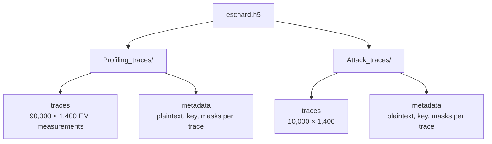
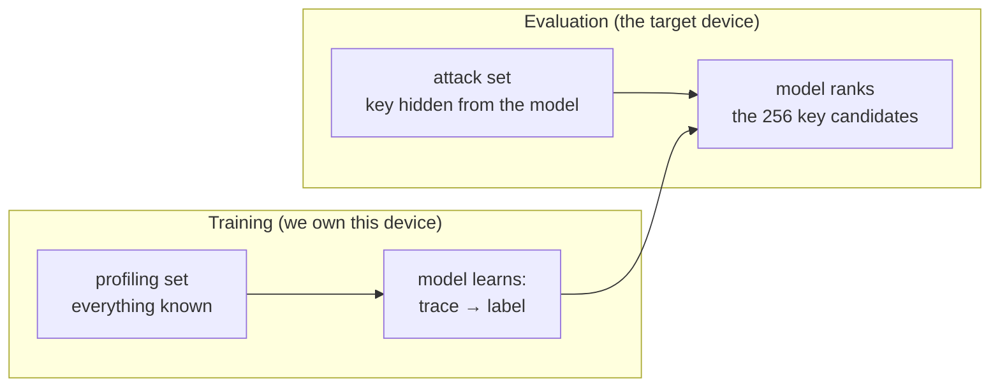
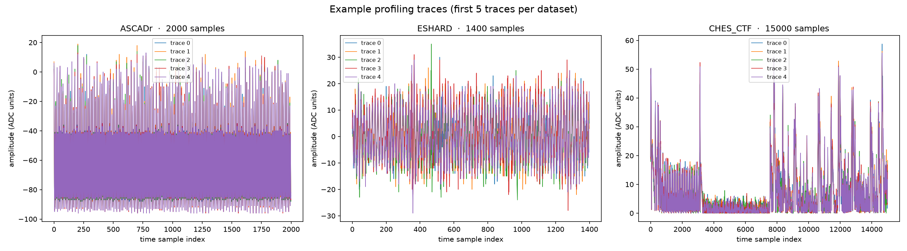
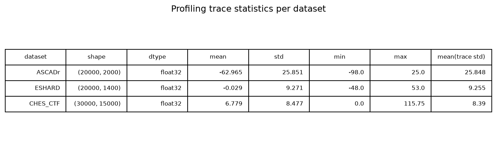

# Chapter 4 — The datasets we will live in

We work with three public datasets, each a collection of side-channel
measurements of AES-128. All three come from implementations protected with
Boolean masking ([Chapter 3](03_masking.md)), and in all three the attack
targets the first encryption round. What changes is the device, the measured
quantity, and the trace length:

| Dataset | Device | Measured | Traces (profiling / attack) | Samples per trace |
|---------|--------|----------|------------------------------|-------------------|
| **ASCADr** | 8-bit AVR microcontroller (ATMega8515) | electromagnetic emissions | 200,000 / 10,000 | 2,000 |
| **ESHARD** | 32-bit ARM Cortex-M4 | electromagnetic emissions | 90,000 / 10,000 | 1,400 |
| **CHES_CTF** | 32-bit ARM Cortex-M4 | power consumption | 30,000 / 10,000 | 15,000 |

The running example for most of what follows is **ASCADr** (identity leakage,
MLP) — and the choice is not arbitrary:

- **It is the community benchmark.** ASCAD has been the standard target for
  deep-learning side-channel research since 2018, so results on it compare
  directly with the published literature — including the paper this manual
  follows, whose mask-recovery experiments run on ASCADr.
- **Its labels keep the full detail.** ASCADr uses the identity leakage model
  (256 classes: the whole S-box output), while ESHARD and CHES_CTF use Hamming
  weight (9 classes). The finer label is what lets later chapters ask *which*
  values the network confuses, not just *how many bits* it tracks.
- **Its metadata include the masks.** Every ASCADr record carries the 18 mask
  bytes of the masking scheme; ESHARD carries 2 and CHES_CTF none. Without
  ground-truth masks we could still train a model, but we could never check
  the central claim of this manual — that the network internally recovers
  secret shares it was never given as labels.
- **It is the easiest to work with.** The largest profiling set (200,000
  traces) and the shortest traces (2,000 samples, `int8`).

ESHARD and CHES_CTF return late in the manual for contrast: what is universal
and what is device-specific. Full field-by-field detail, including download
links: [appendix](appendix_datasets.md).

## Where do the datasets come from?

All three are public benchmarks from the side-channel research community:

- **ASCADr** — the variable-key variant of **ASCAD** (*ANSSI SCA Database*),
  released by ANSSI, the French cybersecurity agency, as a benchmark for
  deep-learning side-channel research
  ([github.com/ANSSI-FR/ASCAD](https://github.com/ANSSI-FR/ASCAD)).
- **ESHARD** — the trimmed public version of the **ESHARD-AES128** dataset:
  electromagnetic measurements of a masked, shuffled AES-128; the trim keeps
  the first round without shuffling.
- **CHES_CTF** — traces released for the **Capture-the-Flag competition of the
  CHES 2018 conference** (Cryptographic Hardware and Embedded Systems), the
  main academic venue of the field.

The raw measurements are far too large to work with directly (hundreds of
thousands of samples per trace), so the paper uses trimmed and resampled
windows around the first AES round — that is what our files contain.

## What is inside each file?

Each dataset is a single **`.h5` file** — an *HDF5* file. HDF5 is a container
format for large numerical arrays, organized like a filesystem: *groups*
(folders) holding *datasets* (arrays). You cannot read it in a text editor;
you open it with a library such as `h5py`:



The `metadata` array is our ground truth. Each record holds the cryptographic
values that produced the trace in the same row. With `plaintext` and `key` we
can compute the leakage label of every trace (see
[Chapter 2](02_intermediate_values.md)):

```python
label = sbox[plaintext[byte] ^ key[byte]]              # identity model
hw    = popcount(sbox[plaintext[byte] ^ key[byte]])    # Hamming weight model
```

## Profiling vs attack

Every dataset is divided into two disjoint sets:

- **Profiling set**: traces where *everything* is known (plaintext, key,
  masks). Used to **train** the model — the deep learning equivalent of
  "profiling the device".
- **Attack set**: traces where the key is *known to the evaluator* but treated
  as *unknown to the attacker*. Used to **test** whether the trained model can
  actually recover the key from fresh measurements.



This mirrors real life: an attacker first trains a model on a device they own,
then uses that same model against a target device of the same type.

## A first look

Each figure below is generated in the companion notebook; here is the summary.

**Trace shapes.** Traces from the three datasets look nothing alike — compare
the short traces of ESHARD with the long, spiky traces of CHES_CTF. The main
reason is the physical measurement itself: ESHARD and ASCADr record the
electromagnetic emanations of the chip with a probe placed near its surface,
while CHES_CTF records the power the chip draws from its supply. The targets
also differ — two ARM Cortex-M4 boards and one 8-bit AVR — so clock speed
and trace length differ too. Within one dataset the setup is fixed, so traces
differ only slightly from one recording to the next; most of that variation
is measurement noise, and the small data-dependent part is what the attack
exploits.



**Scale and noise.** The datasets also differ in numeric scale and dtype:
ASCADr stores raw ADC codes as `int8`, CHES_CTF uses `float16`. This is why
models scale their inputs before training.



The SNR map of *where* the key leaks was the subject of
[Chapter 3](03_masking.md). With the files in hand, the next question is what
function a neural network computes on these traces.

## The exploration notebook

Opening an `.h5` file by hand, reading one metadata record, and computing the
statistics and the SNR is worked through in the
**[data exploration notebook](notebooks/01_the_data.ipynb)**.
